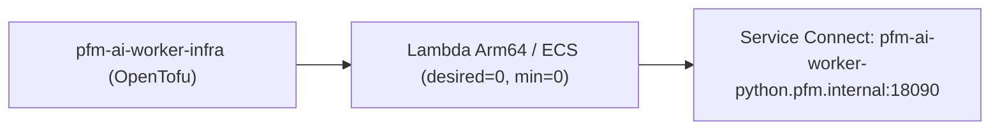

# PFM AI Worker Infra — IaC 1:1 (Serverless / Scale-to-Zero Arm64)

[](CONTRIBUTING.md)
[](CHANGELOG.md)
[](https://sorobanerp.github.io/pfm-docs/)

---

## 1. Visão Geral & Papel na Arquitetura

Infraestrutura dedicada 1:1 para o `pfm-ai-worker-python`: provisionamento **Event-Driven Arm64 (`desired_count = 0`, `min_capacity = 0`)** garantindo **custo US\$ 0,00 em ociosidade**, triggers Kafka/SQS, DLQ cifrada KMS e Rollback Automático S3.

- **Repositório:** `Sorobanerp/pfm-ai-worker-infra`
- **Vínculo com `pfm-docs`:** `ADR-002, ADR-008, ADR-009 | US-09, UC-04`



---

## 2. Pré-requisitos & Variáveis de Ambiente

### Pré-requisitos
- OpenTofu `>= 1.8.0`
- Trivy `>= 0.50`

### Variáveis de Ambiente (Sem Segredos Hardcoded)
| Variável | Padrão | Descrição |
| :--- | :---: | :--- |
| `TF_VAR_compute_engine` | `ecs_fargate_spot` | Motor de compute |
| `TF_VAR_environment` | `prod` | Ambiente alvo |
| `TF_STATE_BUCKET_AWS` | *(CI Secret/Var)* | Bucket S3 de state remoto OpenTofu |

> **Segurança (Zero-Trust):** Nunca commite tokens, senhas, chaves AWS ou strings de conexão com credenciais reais. Utilize `.env` local (ignorado no `.gitignore`) ou AWS Secrets Manager / GitHub OIDC.

---

## 3. Como Executar Localmente

```bash
tofu -chdir=terraform/aws init -backend=false
tofu -chdir=terraform/aws validate
```

---

## 4. Como Testar e Validar

```bash
tofu fmt -check -recursive terraform/
tofu -chdir=terraform/aws init -backend=false && tofu -chdir=terraform/aws validate
trivy config --severity CRITICAL,HIGH --exit-code 1 terraform/
```

---

## 5. Como Provisionar / Validar na Nuvem

1. Fluxo Gitflow: `feat/*` $\rightarrow$ `develop` $\rightarrow$ `release/vX.Y.Z` $\rightarrow$ `main`.
2. Validação FinOps: confirmar `desiredCount = 0` quando sem eventos em fila (`$0,00` ocioso).

Consulte [CONTRIBUTING.md](CONTRIBUTING.md) para regras de Conventional Commits e [CHANGELOG.md](CHANGELOG.md) para histórico de versões.
